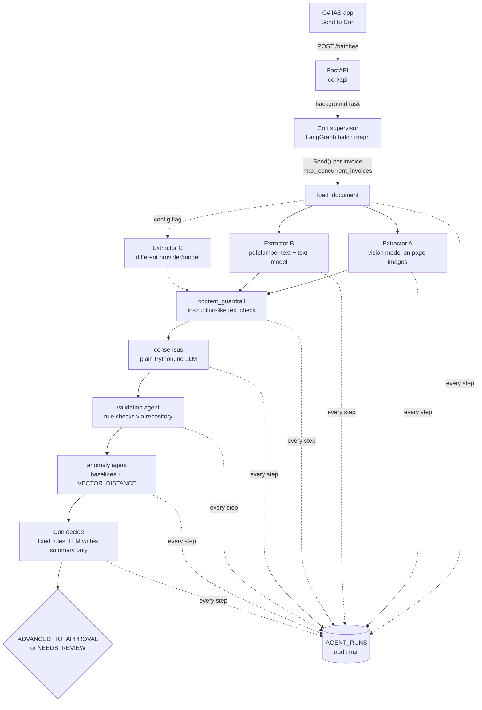

# Cori: multi-agent first-pass invoice review for IAS

Cori replaces the first human review pass on uploaded invoices. In IAS, a user selects a batch and clicks **Send to Cori**. A team of agents then extracts each invoice three independent ways, cross-checks the results, validates them against Oracle, and compares the invoice with history. Cori advances an invoice to the **approval section** only when every check passes. Everything else goes to a **human review queue** with the reasons listed in plain language.

Cori never approves payment. It only moves invoices to the approval section.

This repository is a **working demo**: a Python service with the API the C# app will call, plus a small web page that simulates the "Send to Cori" button. It does not include the C# side.

---

## Status: what has been verified

Verified on 2026-10-13, Windows 11, Python 3.12, **Oracle AI Database 26ai Free 23.26.3**.

| Check | Result |
|---|---|
| `scripts/run_demo.py`, in-process, against Oracle | **14/14** samples reach their expected decision |
| `scripts/run_demo.py --api` (HTTP + background worker) against Oracle | **14/14** |
| Same, with the optional Extractor C turned on | **14/14** |
| `pytest` (unit + SQLite integration + API) | 177 passed, 14 skipped (Oracle opt-in, live LLM) |
| `CORI_TEST_ORACLE=1 pytest -m oracle` | 8 passed (agent-user privileges, `VECTOR` column, full pipeline) |
| Live LLM extraction (Azure OpenAI / Anthropic) | **Not run.** No API keys were available, so every run above used the deterministic `mock` provider (see [Known limitations](#known-limitations)). |
| `docker compose up` | **Not run.** Docker is not installed on the build machine. The demo ran on a native Oracle 26ai Free install instead. |

---

## Quick start

### A. Native Oracle install (how it was built and verified)

```powershell
py -3.12 -m venv .venv
.venv\Scripts\pip install -r requirements.txt      # or requirements-lock.txt for exact versions
copy .env.example .env                             # set the two user passwords, leave ORACLE_PWD blank,
                                                   # LLM_PROVIDER=mock (or azure/anthropic + keys)

# Create the two DB users once, as SYSDBA, in the PDB:
$env:ORACLE_HOME = "C:\app\<you>\product\26ai\dbhomeFree"
sqlplus "/ as sysdba" "@cori\db\migrations\oracle\000_create_users.sql" FREEPDB1 CORI_OWNER <owner_pwd> CORI_AGENT <agent_pwd>

.venv\Scripts\python scripts\run_demo.py            # migrate + seed + run all 14 samples + print expected vs actual
.venv\Scripts\python scripts\setup_demo.py          # reset and register the samples as PENDING for the UI
.venv\Scripts\uvicorn cori.api.main:app --port 8000
# open http://localhost:8000, tick invoices, click "Send to Cori"
```

### B. Docker (Oracle Free container)

```bash
cp .env.example .env              # set ORACLE_PWD and the two user passwords
docker compose up -d oracle       # first start takes a few minutes; wait until it is healthy
python scripts/run_demo.py        # on the host; creates the users as SYSTEM, migrates, seeds, runs samples
docker compose up -d app          # API + UI on http://localhost:8000
docker compose run --rm app python scripts/setup_demo.py   # register samples (paths inside the container)
```

`docker-compose.yml` uses `container-registry.oracle.com/database/free:latest`, which is Oracle AI Database 26ai Free (release 23.26.x). Pin a tag for repeatable builds. Cori only uses SQL that also runs on 23ai Free (`VECTOR`, `VECTOR_DISTANCE`, `IS JSON`).

Uploaded files are stored by absolute path. Register invoices from the same side (host or container) that will process them.

### Other commands

```bash
python scripts/migrate.py --seed            # drop + recreate the Cori schema and seed history
python scripts/run_demo.py --api http://localhost:8000   # run the samples through the HTTP API
python scripts/export_openapi.py            # regenerate docs/openapi.json
pytest                                      # unit + integration (throwaway SQLite, never touches Oracle)
CORI_TEST_ORACLE=1 pytest -m oracle         # Oracle checks (reseeds the CORI_OWNER schema)
pytest -m llm                               # live extraction, runs only when the provider key is set
```

---

## Architecture



* **Batch graph** (`cori/graph/build_graph.py`): `intake -> Send(process_invoice) x N -> finalize`. The fan-out is bounded by `max_concurrent_invoices`.
* **Per-invoice graph**: the extractors run in parallel. The `content_guardrail` node joins them, then consensus, validation, anomaly, and decide run in sequence.
* Every node writes an `AGENT_RUNS` row with the agent name, model, prompt version and hash, raw output, timings, and status. Any decision can be rebuilt from `GET /invoices/{id}/audit`.

### The agents

| Agent | Method | Output |
|---|---|---|
| **Extractor A** | Vision model reads PyMuPDF-rendered page images | `ExtractedInvoice` |
| **Extractor B** | pdfplumber text layer, structured by a text model | `ExtractedInvoice` |
| **Extractor C** (off by default) | Text, with a different provider/model and a different prompt strategy | `ExtractedInvoice` |
| **Content guardrail** | Regex scan of the PDF text layer (catches white or tiny hidden text) plus every extractor's raw output | `CheckResult` |
| **Consensus engine** | Normalize, then compare field by field (`cori/consensus`) | `ConsensusResult` with side-by-side disagreements |
| **Validation agent** | Deterministic rules against Oracle through `db/repository.py` | `ValidationResult` |
| **Anomaly agent** | Historical baselines in USD, rate, frequency, and vector similarity | `AnomalyResult` |
| **Cori** | Fixed routing rules; the LLM writes the summary only | decision + reasons + summary |

Extractors return amounts **exactly as printed** (for example `"12.450,00"`). Deterministic code parses them into `Decimal`, so locale handling never depends on a model. Structured output uses LangChain `with_structured_output` (tool calling). A schema failure is retried once, and then that extractor is marked failed.

---

## How routing decisions are made

Routing is fixed code in `cori/agents/cori.py` (`route()`). No LLM is involved. An invoice is **advanced to approval only if all of these are true**:

1. At least 2 extractors succeeded, **and** they agreed on every critical field: `total_amount`, `currency`, `vendor_name`, `invoice_number`, `matter_number`, `bank_account`, `swift_bic`, plus line item count and amounts. Non-critical fields only need a majority.
2. **Every** validation check passed, including MEDIUM-severity ones.
3. No anomaly flag is MEDIUM or HIGH. LOW flags, such as a cold-start baseline, are shown as notes but don't block.
4. The content guardrail found no instruction-like text aimed at AI systems.

Otherwise the status is `NEEDS_REVIEW`, and **every** reason is listed, most severe first. The LLM summary is checked against the decision: if it doesn't start with "Advanced:" or "Needs review:" to match, the deterministic template summary is used instead.

### Reason codes

| Source | Code | Severity |
|---|---|---|
| extraction | `EXTRACTION_INSUFFICIENT` (fewer than 2 extractors succeeded) | HIGH |
| consensus | `CONSENSUS_CRITICAL_DISAGREEMENT`, `LINE_ITEMS_DISAGREEMENT`, `CONSENSUS_INCOMPLETE` | HIGH |
| guardrail | `PROMPT_INJECTION_SUSPECTED` | HIGH |
| validation | `REQUIRED_FIELD_MISSING`, `VENDOR_NOT_FOUND`, `VENDOR_INACTIVE`, `VENDOR_ID_MISMATCH`, `ARITHMETIC_LINES_MISMATCH`, `ARITHMETIC_TOTAL_MISMATCH`, `MATTER_NOT_FOUND`, `CLIENT_NOT_FOUND`, `MATTER_CLIENT_MISMATCH`, `MATTER_CLOSED`, `DUPLICATE_INVOICE_NUMBER`, `POSSIBLE_DUPLICATE_AMOUNT`, `BANK_DETAILS_MISMATCH`, `BANK_DETAILS_MISSING`, `CURRENCY_AMBIGUOUS`, `INVOICE_DATE_FUTURE`, `INVOICE_DATE_MISSING` | HIGH |
| validation | `CURRENCY_NOT_VENDOR_BILLING`, `INVOICE_DATE_TOO_OLD`, `FX_RATE_MISSING` | MEDIUM (still blocks) |
| anomaly | `TOTAL_ZSCORE_HIGH`, and `RATE_SPIKE` when more than 3x the threshold | HIGH |
| anomaly | `TOTAL_ABOVE_P95`, `TOTAL_ABOVE_GLOBAL_THRESHOLD`, `RATE_SPIKE`, `BILLING_FREQUENCY_HIGH` | MEDIUM |
| anomaly | `COLD_START_BASELINE`, `CURRENCY_NOT_VENDOR_DEFAULT` | LOW (note only) |
| system | `PROCESSING_ERROR` (an unexpected exception for one invoice; the rest of the batch continues) | HIGH |

---

## What each check does

**Consensus** (`cori/consensus`). Values are normalized before comparison:
* dates to ISO 8601
* amounts to `Decimal`, quantized to the currency's minor units
* vendor names: lowercased, punctuation and legal suffixes (LLP, Ltd, GmbH, S.A., K.K., B.V., ...) stripped, then compared with rapidfuzz `token_sort_ratio` against `fuzzy_threshold` (default 90)
* IBAN and account numbers: spaces removed, uppercased
* SWIFT codes: a trailing `XXX` is treated as the primary office

The result is the agreed record plus every disagreement, with each extractor's value side by side.

**Validation**:
* Line items sum to the subtotal, and subtotal + tax equals the total, within one minor unit (so 1 yen for JPY, 0.001 for KWD).
* The vendor exists and is active.
* The client and matter exist, belong together, and the matter is open.
* Duplicates: same vendor and invoice number, or same vendor and total within ±30 days. This searches both IAS history and invoices already submitted to Cori.
* The beneficiary account matches an active account on file. A mismatch is HIGH and the message tells the reviewer to verify with the vendor through a known contact. Account numbers are masked in messages.
* The currency is one of the vendor's billing currencies.
* The invoice date is not in the future and not older than `max_invoice_age_days`.

**Anomaly**:
* Baselines are computed in **USD** after FX conversion: median, mean, std dev, and 95th percentile. The native-currency median and p95 are kept for display.
* Flags fire when the total is above p95 or the z-score is above 3. Both thresholds are configurable.
* **Cold start**: if the matter has fewer than 5 invoices, the baseline falls back to client, then vendor, then a global threshold. The level used and the levels tried are recorded.
* **Rate check**: flags a unit price per timekeeper (or description) more than 30% above the matter's historical average, compared in USD.
* **Frequency check**: flags more invoices from this vendor on this matter in 30 days than about 2x the usual rate.
* **Similar invoices**: line-item descriptions are embedded into `INVOICE_EMBEDDINGS.EMBEDDING VECTOR`. The 5 closest historical invoices come from `VECTOR_DISTANCE(..., COSINE)` at the same baseline level.

---

## Multi-currency handling

* **ISO 4217 reference** (`cori/currency/reference.py`): 159 active codes with their minor units (JPY 0; KWD, BHD, and others 3; CLF 4). The table is seeded into `CURRENCIES`. Demo FX history covers USD, EUR, GBP, JPY, CAD, AUD, CHF, INR, SGD, MXN, BRL, and KWD.
* **Locale parsing** (`parse_amount`) handles `1,234.56`, `1.234,56`, `1 234,56` (including no-break, narrow no-break, and thin spaces), `1'234.56`, `(500.00)`, and embedded symbols or codes. If a single separator is followed by exactly 3 digits, it is read as a thousands separator, unless the currency has 3 minor units.
* **Ambiguous symbols**: `$` maps to USD, CAD, AUD, NZD, SGD, HKD, MXN, ...; `kr` to SEK, NOK, DKK, ISK. Resolution priority:
  1. an explicit ISO code on the invoice
  2. the vendor's known billing currencies, if exactly one of them matches
  3. the vendor's country

  If it is still ambiguous, Cori flags `CURRENCY_AMBIGUOUS` instead of guessing.
* **FX**: `FX_RATES` holds currency→USD rates per day (mock data). Cori uses the rate on the invoice date, or the nearest earlier date, and stores the rate and its date in `AGENT_DECISIONS`.
* **Display**: every amount in the API is `{"amount": "27790.31", "currency": "EUR", "display": "27,790.31 EUR"}`. Amounts are strings, never floats. `Decimal` is used for all money in Python.

---

## Guardrails

* **Agents never write SQL.** All database access goes through parameterized functions in `cori/db/repository.py`. `tests/test_guardrails.py` fails if SQL appears anywhere outside `cori/db`.
* **Two database users.** `CORI_OWNER` owns the schema and runs migrations and seeding. `CORI_AGENT` is what the service uses at runtime. It has:
  * `SELECT` on the reference and history tables
  * write access to `AGENT_*`, `INVOICE_EMBEDDINGS`, `AGENT_DECISIONS`, and `REVIEW_FEEDBACK`
  * no `DELETE` anywhere

  It has two documented demo exceptions on `INVOICES`: `INSERT`, so the upload endpoint can register a PENDING row, and `UPDATE(STATUS)`, so Cori can move an invoice's status. `tests/test_oracle.py` checks that updates, deletes, and inserts against history and reference data fail with ORA-41900 or ORA-01031.
* **Invoice content is untrusted.**
  * Extractor system prompts say the document is data and that any instructions in it must be ignored.
  * The text-model user message wraps the document in `<invoice_document>` tags.
  * The content guardrail flags instruction-like text and forces review, even when extraction fails.
  * The UI escapes all invoice-derived text.
* **Versioned prompts**: `cori/prompts/<id>.v<N>.md`. Each run logs `id.vN#<sha256 prefix>`, so a prompt edited without a version bump is still visible in the audit trail.
* **No secrets in code.** Secrets live in `.env` (gitignored); `.env.example` lists every key.

---

## Configuration (`config.yaml`)

| Key | Default | Meaning |
|---|---|---|
| `extractors.<name>.enabled / method / provider / model / prompt` | A and B on, C off | Which extractors run, and how |
| `consensus.fuzzy_threshold` | 90 | rapidfuzz score for vendor-name agreement |
| `consensus.critical_fields` | see above | Fields that must be unanimous |
| `anomaly.percentile`, `anomaly.z_score` | 95, 3.0 | Total-amount thresholds |
| `anomaly.cold_start_min` | 5 | Minimum invoices for a baseline level |
| `anomaly.global_max_total_usd` | 50,000 | Global threshold used when no level has enough history |
| `anomaly.rate_spike_pct` | 30 | Rate spike threshold |
| `anomaly.frequency_*` | 30 days, 2.0x, min 3 | Frequency check |
| `validation.duplicate_window_days` | 30 | Same vendor + total window |
| `validation.max_invoice_age_days` | 365 | Oldest acceptable invoice date |
| `base_currency` | USD | Currency for baselines |
| `max_concurrent_invoices` | 4 | Invoices processed in parallel per batch |
| `embeddings.provider` | `local` | `local` (offline hashed bag-of-words) or `azure` |
| `summary.use_llm` | true | Let the LLM write the summary (falls back to the template) |

Point `CORI_CONFIG` at another file to override it, for example to turn on Extractor C. `.env` holds connections and secrets: `DB_BACKEND`, `ORACLE_*`, `LLM_PROVIDER` (`azure`, `anthropic`, or `mock`), and the provider keys and deployments.

---

## Mapping the mock schema to the real IAS schema

Every table and column name lives in **one file, `cori/db/mapping.py`**. Repository SQL only uses logical names and aliases every physical column back (`PHYS AS logical`), so to switch to IAS:

1. **Change the right-hand side in `mapping.py`.** For example:
   ```python
   INVOICES = Table("IAS.AP_INVOICE_HDR", invoice_id="INV_ID", vendor_id="SUPPLIER_ID", total="INV_TOTAL_AMT", ...)
   ```
   Nothing else changes, as long as each logical column has a physical equivalent.
2. **Map the status values** at the bottom of `mapping.py` (`STATUS_PENDING`, `STATUS_ADVANCED`, `STATUS_NEEDS_REVIEW`, `STATUS_HISTORICAL`, `STATUS_IN_PROGRESS`) to the IAS workflow states. `STATUS_HISTORICAL` is the status that counts as approved history for baselines.
3. **Keep Cori's own tables** (`AGENT_BATCHES`, `AGENT_BATCH_ITEMS`, `AGENT_RUNS`, `AGENT_DECISIONS`, `AGENT_INVOICE_EXTRACTS`, `INVOICE_EMBEDDINGS`, `REVIEW_FEEDBACK`). Create them in a Cori schema with `001_schema.sql`, minus the reference tables.
4. **Grants**: give `CORI_AGENT` `SELECT` on the mapped IAS tables, and `UPDATE` on only the IAS status column (or replace `update_invoice_status` with a call to an IAS stored procedure, if IAS moves invoices that way).
5. **Joins IAS may model differently** (worth checking first):
   * `MATTERS.client_id`
   * `VENDOR_CURRENCIES`, which IAS may hold as a column instead of a table
   * `VENDOR_BANK_ACCOUNTS.is_active`
   * `FX_RATES`, which is stored as currency→USD; a different pivot means changing `get_fx_rate_to_usd`
6. **Embeddings**: backfill `INVOICE_EMBEDDINGS` for IAS history once (`admin_upsert_embeddings`). New invoices are embedded as Cori processes them.

| Mock table | Purpose | Agent access |
|---|---|---|
| `CURRENCIES`, `FX_RATES` | Reference: minor units, daily rates | read |
| `VENDORS`, `VENDOR_CURRENCIES`, `VENDOR_BANK_ACCOUNTS` | Vendor master | read |
| `CLIENTS`, `MATTERS` | Client and matter master | read |
| `INVOICES`, `INVOICE_LINE_ITEMS` | History and uploaded invoices | read; INSERT + UPDATE(STATUS) on `INVOICES` (demo) |
| `INVOICE_EMBEDDINGS` | `VECTOR(*, FLOAT32)` of line-item text | read/write |
| `AGENT_BATCHES`, `AGENT_BATCH_ITEMS` | Batch progress | read/write |
| `AGENT_RUNS` | Audit trail, one row per agent step (`RAW_OUTPUT` JSON) | read/write |
| `AGENT_DECISIONS` | Decision, reasons, consensus, flags, detail JSON, FX rate used | read/insert |
| `AGENT_INVOICE_EXTRACTS` | Agreed header per processed invoice (duplicate check across submissions) | read/write |
| `REVIEW_FEEDBACK` | Reviewer corrections and cleared flags | read/insert |

Changes from the table list in the original brief:
* added `AGENT_BATCH_ITEMS` (per-invoice progress) and `AGENT_INVOICE_EXTRACTS`
* `INVOICES` gained `SOURCE` and `ORIGINAL_FILENAME`
* `AGENT_DECISIONS` gained `SUMMARY`, `DETAIL`, and `FX_RATE_DATE`
* `AGENT_RUNS` gained `ERROR_MESSAGE`

---

## Sample invoices

`sample_invoices/` is generated by `cori/samples/generate.py` (reportlab, three layouts). The expected decisions are in `sample_invoices/expected_outcomes.json`. Invoice dates are relative to today, so `setup_demo.py` and `run_demo.py` regenerate the PDFs every time.

| Brief case | File | Expected | Key reason |
|---|---|---|---|
| 1 | `01_clean_usd`, `02_clean_eur`, `03_clean_gbp`, `04_clean_jpy` | Advanced | – |
| 2 | `05_anomaly_total_far_above_range` (AUD, 7.5x normal) | Review | `TOTAL_ZSCORE_HIGH`, `TOTAL_ABOVE_P95` |
| 3 | `06_duplicate_of_historical` (CHF, `1'234.56` format) | Review | `DUPLICATE_INVOICE_NUMBER` |
| 4 | `07_bank_details_mismatch` (IBAN at a different bank) | Review | `BANK_DETAILS_MISMATCH` |
| 5 | `08_line_items_do_not_sum` (off by 500.00 EUR) | Review | `ARITHMETIC_LINES_MISMATCH` |
| 6 | `09_ambiguous_dollar_symbol` (`$` only; vendor bills CAD and USD) | Review | `CURRENCY_AMBIGUOUS` |
| 7 | `10_european_number_format_eur` (`11.315,53 EUR`) | Advanced | – |
| 8 | `11_cold_start_new_matter` (MXN, matter with no history) | Advanced | `COLD_START_BASELINE` (LOW note) |
| 9 | `12_rate_spike_timekeeper` (partner about 60% above the usual rate) | Review | `RATE_SPIKE` |
| 10 | `13_prompt_injection` (visible + hidden white text) | Review | `PROMPT_INJECTION_SUSPECTED` |
| 11 | `14_low_quality_skewed_scan` (rotated, noisy, image-only) | Review | `EXTRACTION_INSUFFICIENT` |

"Brief case" is the test case number in the original brief (case 1 covers the four clean invoices).

---

## Project structure

```
cori/
  agents/      cori.py (routing + summary), extractors.py, validation.py, anomaly.py, injection.py
  graph/       build_graph.py (LangGraph batch + per-invoice graphs), state.py
  consensus/   normalize.py, compare.py
  currency/    parsing.py, fx.py, reference.py
  db/          connection.py, repository.py, mapping.py, migrate.py, seed.py, migrations/{oracle,sqlite}/
  llm/         provider.py (Azure OpenAI / Anthropic / embeddings), mock.py (offline stand-in)
  prompts/     versioned prompt files + registry.py
  api/         main.py, routes.py, static/ (demo UI, plain HTML + JS)
  models/      schemas.py (Pydantic v2)
  samples/     demo_data.py (shared dataset), generate.py (PDFs)
  service.py   batch submit/run, decision view, feedback (shared by API and scripts)
scripts/       run_demo.py, setup_demo.py, migrate.py, export_openapi.py
tests/         unit, integration, guardrail, Oracle (opt-in), live LLM (key-gated)
docs/          csharp_integration.md, openapi.json
```

---

## Known limitations

These are demo shortcuts. They matter before production.

* **No real LLM has been exercised.** Every verified run used `LLM_PROVIDER=mock`, a deterministic parser (`cori/llm/mock.py`) that knows the label vocabulary of the three demo templates.
  * Its "vision" extractor rebuilds text from PyMuPDF word boxes. That is a different code path from pdfplumber, but it is not an image model.
  * The Azure OpenAI and Anthropic paths (structured output, image input) are implemented and wired into `tests/test_llm_live.py`, but they have not been run.
  * With real models, expect some outcomes to change, especially the skewed scan: a vision model may read it while Extractor B still fails, which still routes to review.
* **The low-quality scan reaches review because the extractors fail**, not because they disagree. With the mock, the image-only scan has no text layer for either extractor. Real disagreement handling is covered by the consensus unit tests.
* **The prompt-injection check is a regex heuristic.** It can miss rephrased attacks, and it can flag legitimate text such as "please approve this invoice for payment". Both failure modes are fail-safe in the sense that a flag means review. The real protection is that the LLM never makes the routing decision. Instructions that exist only in an image are caught only after a vision model transcribes them.
* **Background work is in-process** (FastAPI `BackgroundTasks`). A server restart abandons running batches. On startup they are marked `INTERRUPTED` and their invoices go back to `PENDING`. Use a real queue in production.
* **Single API worker assumed.** New invoice IDs come from `MAX()+1` under a process lock. Use a sequence when IAS owns invoice registration.
* **Duplicate copies inside the same batch can race.** If two copies of an invoice are processed concurrently, each may finish before the other's extract is saved. Copies in different batches are caught.
* **Embeddings default to a local hashed bag-of-words** (no network). It works for "similar line items" in the demo but has no semantic understanding. Set `embeddings.provider: azure` for real embeddings, then re-seed so stored and query vectors match.
* **FX rates are a mock random walk** around fixed centres. Replace `FX_RATES` with the treasury feed.
* **Re-running `run_demo.py --no-seed`** re-uploads the same samples, and Cori correctly flags them as duplicates of the previous run. Use the default (reseed) for a clean comparison.
* **`docker compose` has not been tested** on the build machine (no Docker). The Python code paths are the same ones verified natively.
